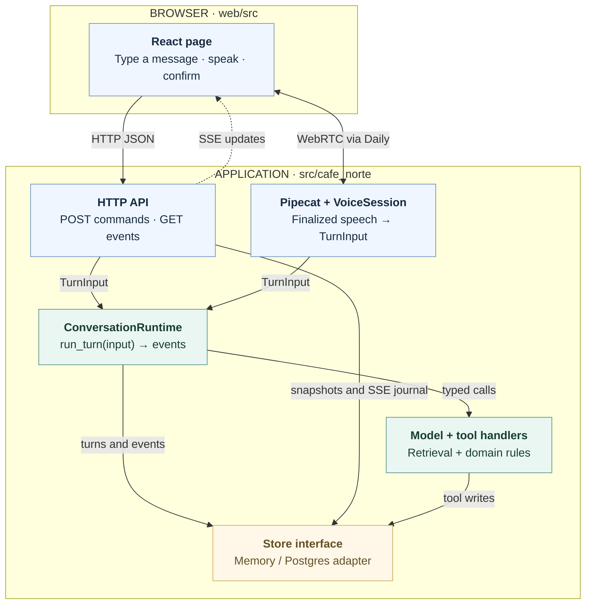

<p align="center"></p>

# Café Norte

Ana is a recruiting assistant you can speak or type to. She collects candidate details,
answers questions about a café role, confirms what she heard, and books a simulated interview.
Each session produces an export with the facts, transcript, sources and usage.

This is a demo: the company and calendar are fictional, and Ana makes no hiring decisions.
Spanish and English have reviewed texts and evaluation cases. Eight additional languages
are supported through model translation; their conversation quality has not been evaluated.

## Run locally

Install [uv](https://docs.astral.sh/uv/) and Node 24. uv supplies Python 3.12 if needed.

```sh
make setup        # install locked dependencies
make run          # build the browser app and serve http://localhost:8000
```

With no `.env`, the app runs offline with a fake model, memory storage and text input.
For real conversations, copy [.env.example](.env.example) to `.env` and configure the model,
voice providers and database there. Provider calls are paid. For browser development,
`make web-dev` serves Vite on port 5173 alongside the API on port 8000.

## How it works

Text and voice share one conversation runtime. It applies domain rules, saves candidate
facts and bookings, and streams updates back to the browser.


<details>
<summary>Mermaid source</summary>



</details>

See the [architecture guide](docs/architecture.md) for module interfaces, communication
protocols, text and voice sequences, and database relationships.

## Check and evaluate

```sh
make check        # Python and TypeScript checks, offline tests and coverage
make test-db      # shared contracts and integration tests on Postgres; requires Docker
make infra-check  # Terraform formatting and validation; requires Terraform ≥1.11
make evals ARGS="--help"
```

Evaluations cover conversation scenarios, retrieval, signals and model comparisons.
`make compare` estimates cost; paid runs require `--yes`. Selected baselines stay tracked in
`evals/results/`. New output is ignored until explicitly promoted with `git add -f <report>`.

Before merging, run `make preflight` for offline, Postgres and live regressions, then
`make preview` for the owner's voice call with real providers.

## Hosting

The demo runs on one Compute Engine VM with Cloud SQL. Daily's native WebRTC transport needs
a routable network interface that the tested Cloud Run deployment did not provide. Text uses
HTTP POST plus SSE: input IDs make retries safe, and event sequences support replay without
a bidirectional WebSocket connection.

A shared access code and request limits guard the hosted demo. See
[infrastructure operations](infra/OPERATIONS.md) for deployment, limits, secrets, recovery and
teardown.
