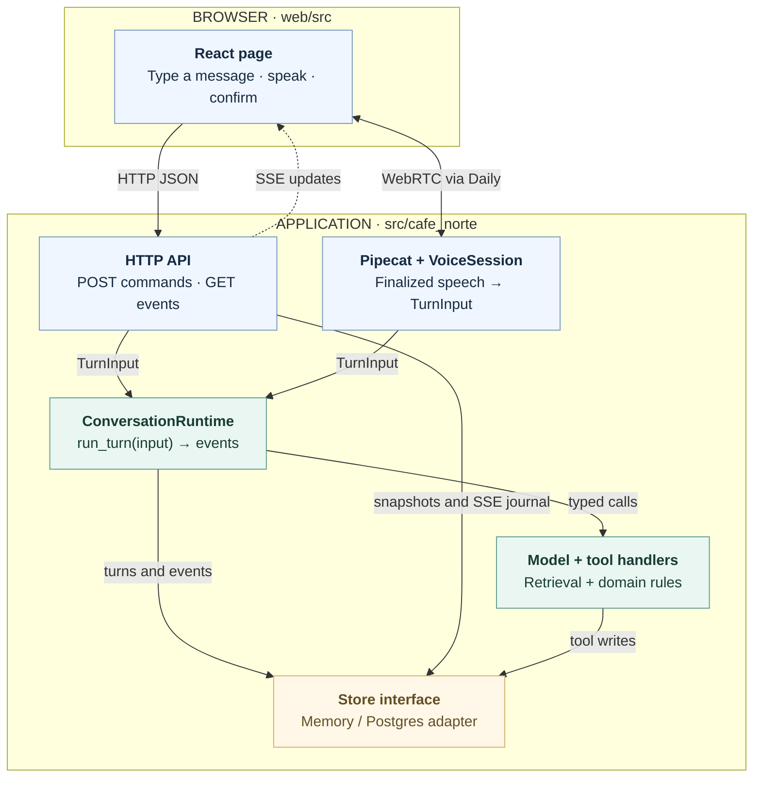

<p align="center"></p>

# Café Norte

Ana is a voice and text recruiting assistant for the fictional Café Norte: she collects and
validates candidate details, answers questions about the role, and books a simulated interview.
Each conversation produces a JSON summary with candidate details, transcript and sources;
Ana makes no hiring decisions.

## Setup

Install [uv](https://docs.astral.sh/uv/) and Node 24. uv supplies Python 3.12 if needed.

```sh
make setup        # install locked dependencies
make run          # build the browser app and serve http://localhost:8000
make check        # lint, types, offline tests and coverage
```

Without configuration, the app uses a fake model, in-memory storage and text input.
For live model and voice providers, copy [.env.example](.env.example) to `.env` and fill in
the relevant settings and API keys; provider calls may incur charges.

See the [Makefile](Makefile) for development, database and evaluation commands.

## System architecture

A React frontend connects to a Python/FastAPI backend, where text and voice share one
conversation engine for model calls, retrieval, validation and booking.
Pipecat handles voice through Daily, Deepgram and ElevenLabs; session data lives in memory
locally or Postgres when configured.



<details>
<summary>Mermaid source</summary>



</details>

See the [architecture guide](docs/architecture.md) for detailed diagrams and protocols.

## Key design decisions

- **Shared engine, validated tools:** One conversation engine keeps text and voice consistent.
  Typed tools validate candidate details and require confirmation before booking.
- **HTTP/SSE and WebRTC:** HTTP commands and replayable SSE events keep text chat and UI
  updates simple; Daily WebRTC handles interactive audio.
- **In-memory retrieval:** A small, fixed knowledge base needs only a lightweight BM25/vector
  index, avoiding a separate vector database to operate. A larger or frequently updated corpus
  would justify a dedicated search service.
- **VM hosting:** Daily's native WebRTC connection failed in the tested Cloud Run setup, so
  the demo uses Compute Engine with Cloud SQL. This gives network control at the cost of
  managing a VM.

## Bonus features

- **RAG:** Hybrid retrieval combines BM25 keyword search with NumPy cosine similarity over
  a precomputed embedding matrix, merging their rankings through reciprocal rank fusion.
  Ragas evaluates retrieval precision and recall.
- **Sentiment analysis:** The optional Jev classifier scores sentiment,
  including frustration, and language choices asynchronously alongside reply generation.
  The runtime waits up to 0.5 seconds extra before first output: early results can adjust
  the reply, while late results inform the next turn.
- **Multi-turn memory:** Ana remembers the current session through recent messages and saved
  candidate facts, shared across text and voice. Postgres preserves that session across restarts.
- **Multiple languages:** Spanish and English have reviewed wording and conversation evaluations;
  eight more languages use model translation without equivalent quality coverage. Explicit
  requests and the optional Jev classifier support language switching during a conversation.
- **Langfuse tracing:** Langfuse groups turn traces by session, showing model
  and tool calls, latency, token usage and estimated model costs.

## Potential improvements

1. **Reliability and scaling:** Load test concurrent calls to find capacity limits. Scale the
   database and run more service instances on VMs behind a load balancer or on Kubernetes.
2. **Reusable interview backend:** Generalize the backend for candidate screening before a
   human interview, with configurable prompts, fields, rules and knowledge bases for any role
   or business.
3. **Real calendar booking:** Connect Calendly or a calendar provider for live availability
   and confirmed interview bookings, with no duplicate reservations.
4. **Telephone calls:** Add Twilio or a similar telephony adapter so candidates can call a
   phone number and use the same conversation engine.
