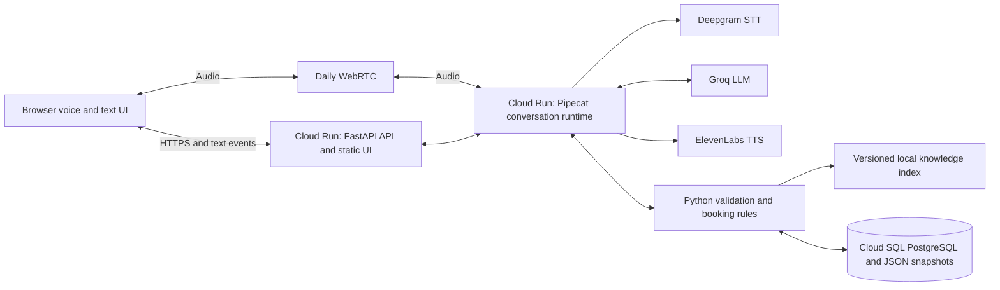

# Café Norte conversational recruiting agent

Project specification · 20 October 2026 · Owner: Iñaki · Status: ready for implementation

> **Amendments (20 October 2026).** The scaffold design settled several choices that differ
> from the text below. Where this document and the table disagree, the table wins; the reasoning
> is in [DECISIONS.md](DECISIONS.md).
>
> | Section | Spec text | Amended to | Decision |
> | --- | --- | --- | --- |
> | §1 Browser | React, TypeScript, Vite | Vanilla ES modules served statically, vendored `daily-js`, no build step | D02 |
> | §1 Application, §8 | SQLAlchemy/Alembic | psycopg 3 with numbered SQL migrations applied under an advisory lock | D03 |
> | §4 Ownership boundaries | Use Pipecat's context and tool-calling machinery for the runtime | Our `ConversationRuntime` owns the loop; Pipecat is the voice shell with one bridge processor | D01 |
> | §10 Endpoints | `WS /api/sessions/{id}/events` | `GET …/events` (SSE with sequence ids and replay) plus `POST …/turns` per text turn | D11 |
> | §11 Cloud SQL | Cloud SQL Python Connector | Cloud Run's built-in Cloud SQL Unix socket; psycopg connects natively | D17 |
> | §13 Evaluation | unspecified tooling | Own typed runner, ragas for retrieval metrics, Langfuse (EU) for traces, datasets, experiments and judge | D05, D06 |
> | §15 Layout | seven modules | plus `model/` and `errors.py`; `contracts.py` per module; architecture test | D04 |
> | §11 Deployment | deploy on `main` | kept: auto-deploy on push to `main`, non-overlapping, docs ignored | D07 |

Build **Ana**, a conversational assistant for a fictional coffee business. A candidate can speak or type in Spanish or English, ask questions about a role, provide their information, correct it, and confirm a simulated interview reservation. The result is a candidate-confirmed factual brief, a complete JSON conversation record, and evidence showing how the system behaved.

This is an independent take-home assessment for Orbio; it is not an Orbio product. The implementation budget is approximately **20 working hours over one week**, with a **€100 total spending ceiling**. All four optional assessment features are in scope: RAG, frustration detection, conversation memory, and multiple languages.

The engineering story is a reliable workflow with measured tradeoffs: natural conversation around code-enforced validation, useful retrieval, reversible corrections, honest failure handling, and observable voice latency and cost.

## 1 Scope and decisions

### Confirmed product decisions

| Area | Requirement |
| --- | --- |
| Business | Fictional Café Norte, one barista role, two store configurations |
| Agent | Ana, an explicitly disclosed AI assistant |
| Channels | Hosted browser voice and text |
| Languages | Spanish for Spain and English, including switching during a conversation |
| Outcome | Candidate-confirmed factual brief and optional simulated interview reservation |
| Hiring decisions | Collect statements and flag questions for human review; no automatic rejection, ranking, or eligibility decision |
| Conversation | Flexible question order, immediate candidate questions, code-enforced validation and confirmation |
| Voice framework | Pipecat, with an early hosted integration checkpoint |
| Data | Fictional applicant details, persisted transcript and state, private resume links; raw audio recording disabled |
| Configuration | Two versioned configurations using the same engine; no configuration editor |
| Review experience | Simple conversation UI, candidate summary, expandable reviewer panel |
| Evaluation | Correctness, retrieval, latency, cost, and one bounded model comparison |
| Infrastructure | Google Cloud in the existing billing account, managed with Terraform |

### Implementation baseline

Use **Google Cloud and Terraform**, reflecting Iñaki's existing account, enabled billing, and familiarity with the services. **Cloud Run** hosts the web application and Pipecat runtime, **Cloud SQL for PostgreSQL** stores persistent state, and **Daily WebRTC** carries browser audio. The hosting choice is settled; project IDs and credentials are deployment inputs.

| Layer | Baseline | Reason |
| --- | --- | --- |
| Application | Python 3.12, FastAPI, Pydantic, SQLAlchemy/Alembic, `uv` lockfile | Typed application and tool boundaries, database migrations, straightforward HTTP hosting |
| Browser | React, TypeScript, Vite; static build served by FastAPI | One public application and one deployment |
| Voice orchestration | Pipecat | Matches the discussed engineering context and exposes the speech pipeline |
| Media transport | Daily | Managed WebRTC between the browser and Python agent |
| STT | Deepgram Nova-3, multilingual mode | Initial Spanish/English streaming transcription |
| LLM | Groq `openai/gpt-oss-120b` | Reuses an available provider account; supports tool use |
| Comparison | Groq `openai/gpt-oss-20b` | One controlled quality, latency, and cost comparison |
| TTS | ElevenLabs `eleven_flash_v2_5` | Initial streaming multilingual synthesis |
| Retrieval | BM25 plus local multilingual embeddings, combined by rank fusion | Exact terms and semantic matching without an embedding API account |
| Embedding implementation | FastEmbed with `sentence-transformers/paraphrase-multilingual-MiniLM-L12-v2` | Small multilingual model runnable on CPU |
| Persistence | Cloud SQL PostgreSQL, including JSONB session/export snapshots | Durable state, transactional reservations, and JSON downloads across container restarts |
| Deployment | Cloud Run service with instance-based billing and one warm instance | Managed HTTPS and container hosting with CPU available during voice sessions |
| Image and secrets | Artifact Registry and Secret Manager | Immutable application images and server-side credentials |
| Monitoring | Cloud Logging and Cloud Monitoring | Operational visibility alongside session-level application metrics |
| IaC | Terraform with protected GCS remote state; Dockerfile and CI | Google Cloud resources and deployment settings are declared in the repository |

These are starting choices, not claims of superior model quality. Pin the actual dependency versions and embedding revision during the first working integration. Record the tested model IDs and voice IDs in every evaluation run. Choose the final ElevenLabs voice by listening to the same short Spanish and English scripts.

Daily carries live audio; Google Cloud runs the application and stores its state; Pipecat coordinates the model services. Do not also introduce Vercel, Supabase, Railway, LiveKit, or Pipecat Cloud in the delivered implementation.

### Explicit exclusions

Real job applications, hiring recommendations, candidate scoring, outbound calling, real calendar or ATS integration, SMS/WhatsApp delivery, phone-number-based identity, voice cloning, raw audio storage, an admin configuration product, and production autoscaling are outside the build.

Document the Twilio integration path and production scaling design. Native speech-to-speech is an architectural alternative to discuss, not a second voice implementation.

## 2 Candidate experience

### Entry

The shared HTTPS page identifies the project as a fictional recruitment demo. It asks reviewers to use invented details and explains that text/transcripts are saved for the demo, while raw audio is not recorded.

The reviewer enters a shared demo access code, selects a store and initial language, and chooses **Talk to Ana** or **Chat with Ana**. Offer a visible fictional candidate card so testers do not need to invent a persona. Request microphone access only after the voice button is pressed. If permission is denied, text remains available.

Ana opens in the selected language:

> Hola, soy Ana, la asistente de IA de Café Norte. Esta es una demostración con datos ficticios. ¿Te viene bien hablar unos minutos sobre el puesto de barista?

Do not say the conversation is an actual outbound call or claim that an SMS will be sent.

### Normal flow

1. Disclose the AI and ask whether the candidate wants to continue.
2. Establish interest in the selected role.
3. Gather the candidate fields in any natural order. Accept several fields in one answer.
4. Answer role and policy questions whenever they arise, then return to the unfinished topic.
5. Present a short factual brief and ask the candidate to confirm or correct it.
6. If the candidate wants an interview, offer two or three available simulated slots.
7. Read back the exact store, date, time, and timezone. Reserve only after explicit confirmation.
8. Show the final brief, simulated reservation result, and a private resume link.

The target conversation lasts approximately three to five minutes. The demo allows eight minutes of active conversation per session, counted across resumes. Reaching the limit ends the conversation but preserves read access to its brief and export.

### Conversational rules

- Ask one main question at a time. Keep ordinary spoken answers to one or two short sentences.
- Allow questions, corrections, language switches, and interruptions at any stage.
- Do not ask again for information already captured unless it is ambiguous, contradicted, or awaiting confirmation.
- After two unsuccessful clarification attempts for a field, mark it unknown and move on. A refusal is recorded as declined.
- Explicit requests to stop, switch language, or speak to a person affect the current turn.
- If interest is explicitly withdrawn, acknowledge it and close. Do not infer disinterest from a frustrated tone.
- Unknown or declined fields must remain visible in the brief. Never fill them with plausible guesses.
- A human follow-up request is saved for review. Explain that this demo does not contact a real recruiter.

### Two store configurations

| Configuration ID | Fictional location | Role variation | Purpose |
| --- | --- | --- | --- |
| `chamberi_barista_v1` | Café Norte Chamberí, Madrid | 35 hours per week; morning and afternoon shifts | First happy path |
| `arganzuela_barista_v1` | Café Norte Arganzuela, Madrid | 20 hours per week; afternoon and weekend shifts | Different policy and calendar context |

Use `Europe/Madrid` for both stores. Each configuration references its own offer information, store details, shift definitions, and calendar. All employment terms and addresses used in the demo must be explicitly fictional and internally consistent.

The selected configuration is fixed for a session. A request to apply to the other store starts a new session after confirmation, rather than silently mixing facts or reservations between configurations.

## 3 Candidate data and confirmation

### Field contract

Every conversationally collected field carries `value`, `status`, `source_turn_id`, and supporting `evidence_text`. Status is one of `unset`, `captured`, `confirmed`, `unknown`, or `declined`. Unset, unknown, and declined values are null. Evidence refers to finalized user text, never an STT interim. Preferences selected through the UI reference their input event instead of inventing a source turn.

| Field | Shape and validation | Confirmation and treatment |
| --- | --- | --- |
| `name` | Trimmed Unicode string, 1–100 characters; mononyms allowed | Included in brief confirmation |
| `contact_phone` | Optional fictional number, normalized to E.164 when supplied | Read back if supplied; never used as authentication |
| `interest` | `yes`, `unsure`, or `no`, based on the candidate's statement | Do not turn sentiment into interest |
| `work_authorization` | Self-reported `yes`, `no`, or `unsure` | `no` or uncertainty creates a human review flag; does not block booking |
| `availability.days` | Set of weekday enums | Keep specific restrictions in notes |
| `availability.shifts` | Set of configured shift IDs | Resolve ambiguous names against the selected store |
| `availability.hours_per_week` | Integer 1–60, or unknown/declined | A validation bound, not an eligibility threshold |
| `earliest_start_date` | ISO date; interpret relative language using session date and timezone | Read back the resolved date; clarify past or ambiguous dates |
| `experience` | Candidate's own short factual description, maximum 500 characters | No inferred skill score or personality assessment |
| `preferred_language` | `es` or `en` | Changes immediately on an explicit request |

The server sets store, role, IDs, versions, timestamps, and booking details. The model cannot change these through a candidate update.

Do not collect age, nationality, home address, health, family circumstances, or other unrelated personal details. Do not infer commute time from a postcode. Store preference is already established by the selected configuration.

### Versioned confirmation

Each accepted fact update increments `record_revision`. Brief confirmation references the exact revision presented to the candidate. Any subsequent fact correction invalidates that confirmation and triggers an updated recap.

Phone and date read-backs use an explicit pending confirmation. A bare “yes” is only meaningful when it answers the current pending confirmation. A correction, interrupted read-back, expired slot offer, or unrelated “yes” cannot authorize a reservation.

The confirmation record includes its type, target revision or slot ID, presentation turn, response turn, and result. The candidate may also use an explicit browser confirmation button bound to the same pending confirmation.

### Completion and review

Track these independently:

- `lifecycle`: `active`, `paused`, `completed`, `stopped`, `abandoned`, or `failed`.
- `outcome`: `reserved`, `brief_only`, `not_interested`, `human_followup_requested`, or `incomplete`.
- `review_flags`: factual issues that need a person to examine.
- `booking`: absent or a committed simulated reservation.

A confirmed brief with explicitly unknown or declined fields can be completed. Before normal brief confirmation, every requested field must be captured, confirmed, unknown, or declined; an unset field must be addressed first. Early exits retain a partial, unconfirmed brief. Human review flags can coexist with a reservation. There is no `not_eligible` status.

## 4 Architecture and conversation runtime



### Ownership boundaries

One `ConversationRuntime` owns history, prompt assembly, tool execution, turn cancellation, and assistant output for a session. Use Pipecat's context and tool-calling machinery for this runtime. The text adapter injects finalized text and consumes assistant text through the same orchestration path; it does not implement a separate agent.

Keep candidate schemas, validation, allowed transitions, confirmation checks, retrieval, and booking functions independent of Pipecat. Test these directly without model calls.

The LLM proposes candidate updates and conversational actions. Code validates inputs, binds them to the authenticated session and fixed configuration, and decides whether mutations are permitted. Server state is authoritative; the transcript is not a substitute for that state.

Use one API process per container and target one active Cloud Run instance initially. Maintain a session actor/lock per active conversation, backed by a database ownership lease. Serialize mutations, reject duplicate input IDs, and allow only one active channel connection per session. Switching from voice to text cancels pending speech before accepting the next text turn.

A scaling setting is not a global lock: container replacement and deployments can overlap. Claim sessions and admission slots transactionally in Postgres. Renew ownership leases while active and require the current ownership generation for mutations; an expired or superseded worker must stop. If a request reaches an instance that does not own an active conversation, return a reconnect response rather than creating a second runtime. Recover abandoned ownership through an authorized resume after lease expiry.

### Turn execution

1. Accept one finalized user turn with a unique ID; persist it.
2. Apply explicit stop/language/human-request controls and cancel stale output.
3. Supply the runtime with recent history, validated candidate state, pending confirmation, unfinished fields, and the fixed configuration.
4. Stream the LLM response. Validate every proposed tool call before execution.
5. Persist mutations and tool results before announcing successful actions.
6. Stream the spoken answer or text reply; track what was generated, sent, and interrupted.
7. Persist turn timings and usage. Run nonessential signal analysis asynchronously.

Use a bounded tool loop: maximum four tool rounds per user turn. One malformed-call repair is allowed; repeated failure produces a short explanation and a safe continuation or human follow-up option.

Only tools from the application allowlist are exposed. Provider web search, code execution, shell access, and arbitrary URL fetching are disabled.

### Tool contracts

| Tool or internal action | Inputs | Server-owned behavior |
| --- | --- | --- |
| `update_candidate` | Allowed field patch, source turn, evidence | Validate, apply correction, increment revision, invalidate stale confirmation |
| `search_knowledge` | Candidate question | Apply session configuration and KB version filters; return snippets with source IDs |
| `list_interview_slots` | Optional date preference | Return available future slots for the selected store |
| `present_confirmation` | Field and value revision, brief revision, or proposed slot ID | Build canonical recap/read-back and register pending confirmation |
| `confirm_field` | Pending field confirmation and response turn | Confirm the exact phone/date value that was presented |
| `confirm_brief` | Pending confirmation and response turn | Confirm only the current presented revision |
| `reserve_interview` | Slot ID and matching confirmation | Validate intent and availability; commit idempotently |
| `request_human_followup` | Reason and supporting turn | Save a request and explain its demo-only effect |
| `end_session` | Allowed reason | Persist final state and stop provider/media resources |

Session IDs, configuration IDs, authorization, and idempotency keys are injected by the server, not trusted from model arguments. The same confirmation rules apply to model-driven actions and browser buttons.

Live tool calls use streaming tool support plus Pydantic validation. Separate post-session structured generation may be used for a narrative summary. Do not assume strict JSON-schema response mode, streaming, and tool use can all be combined in one Groq request; its documented restrictions must be respected. [Groq structured outputs](https://console.groq.com/docs/structured-outputs)

## 5 Voice behavior and latency

The voice path is:

`Daily input → VAD and turn detection → Deepgram → conversation runtime and tools → ElevenLabs → Daily output`.

Use Pipecat-supported voice activity detection and semantic turn detection where compatible with the pinned version. Start with its supported defaults and adjust against the fixed demo scripts. Stream transcription, model output, and speech; never wait for a full long paragraph before beginning TTS.

Required behavior:

- The candidate can interrupt Ana. Stop queued speech and cancel obsolete generation/tool reads where possible.
- A committed booking remains committed after an interruption; reconcile from storage before any retry.
- Do not treat the unplayed remainder of an interrupted read-back as heard or confirmed.
- Keep generated text distinct from the best available delivered-speech information. Record limitations in playback acknowledgement.
- Normalize dates, times, money, and phone numbers before TTS; the visible text retains the canonical values.
- Display listening, thinking, and speaking states. Show STT interim text as provisional only.
- After eight seconds of silence, give one short prompt. After a further twelve seconds, pause the session and release voice resources.
- Give a visible warning near the eight-minute limit, persist the partial brief, and close cleanly at the limit.

Warm the embedding model and knowledge index before readiness. Keep provider connections open during a call. Summaries and sentiment analysis must not delay the ordinary response.

An acknowledgement such as “Voy a comprobar los horarios” is allowed when a tool is actually running. It must not count as the useful answer in latency reporting.

### Measurement targets

These are engineering targets to evaluate, not promised results:

| Measurement | Target or reporting requirement |
| --- | --- |
| Warm simple turn, end of user speech to first useful audible answer | Median ≤1.2 seconds; p95 ≤2.5 seconds |
| Retrieval and booking turns | Report separately, including tool duration |
| Barge-in to stopped playback | Aim for ≤300 ms in the tested browser/network |
| Hosted start to connected voice session | Measure cold and warm startup separately |
| Text turn | Report first token and final response duration |

Use browser monotonic timestamps for browser-observable audio events when possible. Record server stage durations separately; do not subtract unsynchronized client/server clocks. If only server audio-send timing is available, label it as a proxy rather than perceived latency.

## 6 Retrieval augmented generation

Author **12 short Spanish Markdown documents**, with bilingual titles/keywords where useful:

1. Company and demo description.
2. Barista responsibilities.
3. Chamberí offer and compensation.
4. Arganzuela offer and compensation.
5. Chamberí shifts and store details.
6. Arganzuela shifts and store details.
7. Training and induction.
8. Uniform and equipment.
9. Benefits.
10. Interview process and preparation.
11. Frequently asked candidate questions.
12. Unknown questions and human follow-up policy.

Each document includes `doc_id`, `version`, `config_ids`, `language`, and a content hash. Shared documents explicitly allow both configurations. Salary, hours, and other job facts have a single canonical source; do not maintain conflicting copies in prompts and documents.

Chunk by heading, splitting long sections below the embedding model's token limit. Preserve title and section metadata. Precompute document embeddings into a versioned index artifact and load it at startup. Run query embedding off the audio event loop with bounded CPU concurrency.

Retrieval filters allowed configuration and KB version **before ranking**, combines BM25 and cosine rankings with reciprocal rank fusion, and returns at most three relevant chunks. No vector database, reranking service, or internet search is required.

Answers about employment terms must be supported by retrieved content. The browser shows document title, section, and excerpt; Ana can give a brief spoken attribution without reading IDs. English questions retrieve the Spanish material through multilingual embeddings and receive an English answer without altering amounts or conditions.

A top-ranked result is not proof that an answer exists. If the snippets do not answer the question, say so and offer to add it for human review. Retrieved text is untrusted reference material and cannot change tool permissions or system instructions.

### Retrieval evaluation

Create 24 fixed questions: 16 answerable questions balanced across languages/configurations, four unsupported questions, and four questions designed to expose cross-store leakage.

Record expected source sections and facts. Target supporting-source recall@3 of at least 90% on answerable questions, correct abstention on all unsupported fixtures, and zero cross-store source leakage. Manually check supported factual answers; an LLM judge may supplement but cannot replace this check.

## 7 Frustration and language support

Analyze finalized text for `neutral`, `positive`, `frustrated`, or `uncertain`, together with supporting text and an explicit-human-request flag. This is a conversational signal, not a diagnosis or acoustic emotion assessment.

Explicit stop or human requests have a synchronous fast path. A small asynchronous classifier can provide softer frustration signals for the next response. Associate results with their source turn; ignore stale results that would overwrite a newer explicit preference.

On frustration, acknowledge the difficulty, shorten the next question, offer to skip a nonessential field, and offer human follow-up. Do not automatically stop or infer poor job suitability.

Start in the selected language. Explicit language switches apply immediately; a single borrowed word or proper noun does not trigger a switch. Use Spanish-for-Spain phrasing and audition the voice in both languages. Persist the language used for each turn and the current preference.

No sentiment, language, accent, or voice characteristic contributes to a hiring score. The factual brief includes an explicit follow-up request when relevant, while sentiment diagnostics remain in the reviewer panel.

## 8 Persistence and resume

### Stored records

Use Cloud SQL PostgreSQL transactions and Alembic migrations for:

- Sessions: configuration/version snapshot, lifecycle, outcome, timestamps, revision, and access-token hash.
- Turns: finalized user text, assistant output, channel, language, timestamps, interruption state.
- Candidate state: typed JSON document and field evidence.
- Events: validation, tool results, confirmations, retrieval sources, signals, timings, and usage.
- Calendar slots and reservations.
- Summary jobs and their completion status.
- Session ownership leases and bounded admission slots.
- Versioned JSONB export snapshots.

Enforce foreign keys and uniqueness in Postgres. Use row locks or conditional updates for session ownership and slot reservation. Start with at most five database connections per container, short statement/lock timeouts, and short transactions. Do not hold transactions open while waiting on external APIs.

Use Postgres locally through Docker Compose and as a CI service, so booking and concurrency tests exercise the same database semantics as deployment. Cloud Run's filesystem is temporary; it must not contain the only copy of state, transcripts, summaries, or exports.

### JSON requirement

At session close, store a versioned JSONB export from one consistent database snapshot. Expose it as an authenticated `<session_id>.json` download with the correct content type and filename. Regenerate the snapshot after an authorized correction or completed summary job. Local CLI exports may also write `data/exports/<session_id>.json`; hosted persistence does not depend on that directory.

The export contains:

```json
{
  "schema_version": "1",
  "session": {},
  "candidate": {},
  "transcript": [],
  "confirmations": [],
  "booking": null,
  "review_flags": [],
  "retrieval_events": [],
  "signals": [],
  "summary": {},
  "metrics": {},
  "versions": {}
}
```

Publish the concrete JSON Schema generated from Pydantic and one complete fictional example. Include all exported values needed to understand a session; never export access codes, provider credentials, resume tokens, or raw audio.

The candidate-confirmed brief is a deterministic rendering of the accepted record. A post-session narrative summary may improve readability but cannot override facts, invent confirmation, or become the source of truth. If generation fails, use the deterministic brief. Persist the pending summary job and retry it after restart, at most twice.

### Private resume

Generate a cryptographically random resume token with at least 256 bits of entropy; store only its hash. The URL places the token in a fragment, and the browser exchanges it for a session-scoped HttpOnly cookie before removing it from the address bar. Use HTTPS, SameSite cookies, same-origin checks, and `Referrer-Policy: no-referrer`. Do not include third-party analytics.

Resume links expire after seven days and grant access only to their own conversation. Knowing a phone number or session ID grants no access. A resumed call gets a new media room and connection token.

Restore validated state, previous confirmation status, questions, and reservation. Ask whether the candidate wants to continue; do not silently rebook. Preserve the original configuration/KB version. If it is no longer available, show the previous brief and request a new session.

Retain demo sessions for seven days. Run bounded cleanup at startup and periodically in the application, and provide an authenticated delete-session action. Use a database lock so overlapping containers do not duplicate cleanup work. Deletion removes its live records, exports, token, and simulated reservation. Configure a short, documented Cloud SQL backup retention period; deleted records can remain in backups until that period expires. Provider-side retention remains governed by the configured provider accounts; do not promise it matches application deletion.

## 9 Simulated calendar

Seed a small set of future 30-minute interview slots for each store over the next seven days. Persist slot IDs and UTC timestamps with `Europe/Madrid` display timezone; reseeding must not recreate or overwrite occupied slots.

A reservation requires:

1. An active authenticated session.
2. A candidate-confirmed current brief.
3. Explicit intent to schedule.
4. A matching, fully presented slot confirmation and affirmative response.
5. A future, still-available slot belonging to the selected store.

No work-authorization or frustration field is a booking gate.

Enforce a unique reservation per slot and at most one active reservation per session in the database. A server-generated idempotency key binds the session and confirmation. On a duplicate request, return the original result; on a conflict, offer fresh slots. After a timeout with an unknown commit result, query by idempotency key before retrying.

Only announce a reservation after the transaction commits. Show **Simulated reservation — no real appointment created** in the UI and export. After booking, requests to change the appointment are recorded for human follow-up; automated rescheduling is outside this version.

## 10 Browser and API contract

### Browser layout

Use a compact, responsive single-page interface with:

- Store, language, and voice/text entry controls.
- Main conversation area with transcript, status, mute, stop, and text composer.
- Candidate brief with captured, confirmed, unknown, and declined states.
- Confirmation cards and simulated reservation result.
- Private resume link, JSON download, and delete-session controls.
- Expandable reviewer panel for the current authorized session.

The reviewer panel shows source turns, corrections, retrieval excerpts, validation errors, tool outcomes, configuration/model/prompt/KB versions, timings, and estimated usage. It does not expose hidden reasoning or raw chain of thought.

Use semantic labels, keyboard-operable controls, readable contrast, and visible error messages. The browser must handle denied microphone permission and a broken voice connection without losing the saved state.

### Minimal endpoints

| Endpoint | Purpose |
| --- | --- |
| `POST /api/access` | Validate shared demo access code; issue access cookie |
| `GET /api/configurations` | Return public store and role choices |
| `POST /api/sessions` | Create a session with configuration, language, and channel |
| `POST /api/sessions/{id}/voice` | Authorize, allocate a private Daily room, and start the voice task |
| `WS /api/sessions/{id}/events` | Authenticated text input and live assistant/state events |
| `GET /api/sessions/{id}` | Read the authorized session snapshot |
| `POST /api/sessions/{id}/confirmations/{confirmation_id}` | Apply explicit UI confirmation through domain rules |
| `POST /api/resume` | Exchange private resume token for session authorization |
| `POST /api/sessions/{id}/end` | End and finalize a session |
| `GET /api/sessions/{id}/export` | Download consistent JSON |
| `DELETE /api/sessions/{id}` | Delete the authorized demo session |
| `GET /health/live` and `GET /health/ready` | Process and initialized-service health |

All session endpoints check ownership. Mutations include an input ID and expected revision where applicable. The shared demo code alone must not grant access to other candidates' records. Validate WebSocket origins and authorization as strictly as HTTP endpoints.

Events include `session_id`, `turn_id` where applicable, a monotonic sequence number, event type, and payload. On reconnect, fetch the persisted snapshot; replay of every transient token is unnecessary. A typed turn is either acknowledged once or safely resubmitted with the same input ID.

## 11 Hosting and infrastructure as code

### Deployment shape

Deploy one Docker image containing the Python application, compiled frontend, fixed KB, and embedding artifacts to **Cloud Run**. FastAPI listens on `0.0.0.0:$PORT` and serves the UI, HTTP endpoints, and text events; Pipecat voice tasks run in the same container with bounded admission. Use the default managed `run.app` HTTPS URL, so the demo needs no custom domain, load balancer, or certificate provisioning.

Use a dedicated demo project under the existing billing account, or an explicitly selected existing project. Do not provision into an inferred default project. Default to `europe-west1`, with Cloud Run, Cloud SQL, and Artifact Registry colocated; expose the region as a Terraform input. Appointment times remain `Europe/Madrid`.

| Resource or setting | Initial configuration |
| --- | --- |
| Cloud Run service | Second-generation execution environment; 1 vCPU and 2 GiB RAM |
| CPU allocation | Instance-based billing / CPU always allocated |
| Warm capacity | Minimum one instance during development and the agreed review window |
| Scaling target | Maximum one instance initially; database admission remains authoritative |
| HTTP concurrency | 20 requests per instance; independent of the two-call voice limit |
| HTTP/WebSocket timeout | 600 seconds; application conversation cap remains 480 active seconds |
| Session affinity | Enabled as a routing aid, never an ownership guarantee |
| Startup probe | Readiness after model/index load and database connectivity |
| Liveness probe | Process responsiveness; a provider outage must not cause a restart loop |
| Cloud SQL | PostgreSQL 16, Enterprise edition, single zone, initial `db-g1-small` tier and 10 GiB SSD |
| Cloud SQL backups | Three retained automated backups; no HA replica for this demo |
| Artifact Registry | One regional Docker repository; images deployed by digest |
| Secret Manager | Named secrets with explicit version references in each deployed revision |
| GCS | Private, versioned Terraform state bucket; no application filesystem mount |

These sizes are starting values to test, not capacity guarantees. If two voice sessions overload one vCPU, reduce admission to one before increasing compute and revising the cost estimate.

Instance-based billing keeps CPU available after the session-start HTTP response, which is necessary for our Daily bot tasks. A minimum instance reduces cold starts but does not guarantee uninterrupted process lifetime. Persist state and handle shutdown/reconnect explicitly. [Cloud Run CPU allocation and lifecycle](https://docs.cloud.google.com/run/docs/configuring/billing-settings)

The browser's control/event WebSocket stays connected during an active conversation. Its timeout and disconnect behavior must be tested; the request timeout does not govern Daily's separate media connection. Cloud Run session affinity is best effort, so ownership stays in Postgres. [Cloud Run WebSockets](https://docs.cloud.google.com/run/docs/triggering/websockets)

Use the Cloud SQL Python Connector with the runtime service account and a small connection pool. For this demo, use the instance's public endpoint through the authenticated connector, with no authorized-network allowlist or open database access. Store database credentials in Secret Manager. This avoids adding a VPC connector, NAT gateway, or private networking setup to the take-home. [Cloud Run to Cloud SQL](https://docs.cloud.google.com/sql/docs/postgres/connect-run)

All business logic remains in Python. Cloud SQL replaces local persistence; it does not execute the conversation. Daily carries media and does not host the agent. Provider credentials remain on the server.

Daily rooms are private, limited to the bot and one candidate, and expire shortly after the session limit. Issue short-lived room-scoped tokens and enable expiry/ejection behavior. End rooms and close model streams when sessions end. Room provisioning failures must not leave an orphan bot running.

### Why this Google Cloud design

Cloud Run gives us managed HTTPS and a container deployment without VM patching or certificate management. Cloud SQL keeps state outside replaceable containers. The deliberate cost is a warm, CPU-allocated service and a small continuously billed database during the demo window.

Do not mount Cloud Storage as a SQLite database or assume a Cloud Run container survives indefinitely. Compute Engine is a possible fallback if the early hosted audio checkpoint exposes a runtime limitation, not a second deployment to build. GKE, a separate worker pool, and production HA are outside the 20-hour scope.

### Reproducibility contract

Given accounts, billing setup, and credentials, a new environment must be deployable from the repository without recreating service settings manually.

| Artifact | Responsibility |
| --- | --- |
| `Dockerfile` and dependency lockfiles | Build the same application and bundled assets |
| `infra/bootstrap/` | Terraform for the state bucket and initial deployment identity/federation |
| `infra/app/` | APIs, service accounts and scoped IAM, Artifact Registry, Secret Manager, Cloud SQL, Cloud Run, monitoring, billing budget |
| `infra/environments/demo.tfvars.example` | Nonsecret project, region, sizing, budget, and image inputs |
| `scripts/bootstrap.*` | Run bootstrap, configure the backend, and populate provider secret versions |
| `compose.yaml` | Local Postgres and the application development environment |
| `.github/workflows/ci.yml` | Terraform checks, lint, type checks, Postgres-backed tests, frontend build |
| `.github/workflows/deploy.yml` | Build/push immutable image, review/apply Terraform plan, migrate database, smoke-check deployment |
| `scripts/teardown.*` | Drain sessions and explicitly remove demo resources while preserving state/backups until selected for deletion |
| `.env.example` | Names and descriptions only; no secret values |

Pin Terraform/provider versions and commit the provider lockfile. Manage the Cloud Run image digest and configuration through Terraform so application deployment does not silently drift from infrastructure state. Database schema migrations remain versioned SQL/Alembic operations.

Use a GCS backend with state locking, restricted access, public access prevention, and object versioning. Bootstrap the backend once with local state, then migrate that bootstrap state into its own GCS prefix. The application stack uses a different prefix. Terraform state can contain database credentials even when variables are marked sensitive; protect it as secret material and never commit it or expose plan files in public CI artifacts. [Terraform GCS backend](https://developer.hashicorp.com/terraform/language/backend/gcs)

Use local Application Default Credentials during setup and GitHub Actions OIDC with Workload Identity Federation for CI. Restrict federation to the selected repository and deployment branch/environment; do not create a long-lived Google service-account key. Keep deployment permissions separate from the runtime identity. Runtime access is limited to required secret versions, the database connection, and application logging. [Workload Identity Federation](https://docs.cloud.google.com/iam/docs/workload-identity-federation-with-deployment-pipelines)

Terraform declares secret resources and access policies. Populate external provider API keys outside Terraform through the documented secret-upload command; only secret names/version references belong in service configuration. Configure a restricted database application role, with migrations using a separate privileged role.

The initial sequence is bootstrap and base resources, secret population, image build/push, then application deployment. Use separate Terraform stacks so the first run does not depend on an image or secret version that does not yet exist. Thereafter, deployments use a single reviewed image digest and plan. CI runs migrations through the authenticated database connector with its migration identity, once under a database lock, before switching traffic. A failed migration or readiness check prevents promotion. Use backward-compatible migrations for changes that must support rollback to the previous image.

Expose the Cloud Run service publicly so reviewers can load the page, while enforcing the shared demo code and session authorization in the application. Do not expose database credentials, Secret Manager access, or Terraform state to the browser. If the selected project's organization policy prevents public invocation, resolve that during the first checkpoint rather than bypassing the policy.

A repeated plan should show no unintended changes. Test a fresh deployment plus a forced container restart/revision replacement that preserves the candidate record and reservation. Include an uptime check and a small alert policy for sustained HTTP errors; detailed conversation quality remains in the reviewer panel and evaluation report.

### Operational limits

Start with at most two active voice sessions, three session starts per access session per hour, an eight-minute call limit, and a configurable total demo-minute allowance. Validate two-call capacity during the hosted checkpoint; reduce admission to one if the selected instance cannot sustain it.

Reject excess work with a clear retry message. Count pending starts as capacity use and enforce admission in Postgres, including during overlapping revisions. HTTP concurrency is not a count of active Daily calls. Inbound HTTP, text length, and per-session turns also have limits.

Deploy only after draining active sessions for this demo. On SIGTERM, stop admission, persist and pause owned sessions, and release provider/media connections within Cloud Run's shutdown grace period; do not try to finish an eight-minute call during shutdown. A replacement instance allows authorized resume, not transparent migration of a live audio stream.

Set an explicit demo availability end date before provisioning. After the review, drain and tear down or deliberately suspend the stack. Lowering Cloud Run's minimum to zero does not eliminate Cloud SQL, storage, registry, or logging charges. This single-instance target and single-zone database are not a high-availability design.

## 12 Cost and failure handling

### Budget

These are planning allowances in euros, not provider price quotes:

| Category | Allowance |
| --- | ---: |
| Google Cloud runtime, database, storage, builds, and monitoring | €30 |
| STT | €10 |
| TTS | €25 |
| LLM calls and evaluation | €10 |
| Media transport | €5 |
| Reserve for tax, currency differences, retries, and sizing changes | €20 |
| Total ceiling | €100 |

Reuse the existing Google Cloud account with billing and the Groq API account. Create Daily, Deepgram, and ElevenLabs accounts as needed. Consumer Claude/Codex OAuth credentials are development tooling, not runtime application credentials.

Maintain a versioned price table with currency and verification date. Log LLM input/output tokens, TTS characters, STT duration, and Daily participant-minutes. Separate estimated marginal session cost from subscriptions and shared hosting cost. Count retries and canceled generations when billed or conservatively estimated.

Reserve estimated spend before admission, reconcile after usage, and stop admitting sessions before the allowance is exhausted. Use provider limits where available and review actual billing during development. An application estimate or billing alert alone cannot guarantee an exact account-wide cap.

Estimate Google Cloud spend before provisioning using the selected region, Cloud Run CPU/memory and uptime, Cloud SQL tier/storage/backups, registry/builds, egress, and monitoring. The €30 allocation assumes a bounded development/review window, not indefinite hosting. Existing billing/free-tier credits are a possible discount, not the budget strategy. [Cloud Run pricing](https://cloud.google.com/run/pricing), [Google Cloud pricing calculator](https://cloud.google.com/products/calculator)

Declare a project-filtered billing budget with alerts at 50%, 80%, and 100% of the Google Cloud allocation. A budget alert is not a shutdown mechanism. Use supported Cloud Run spend-cap controls where available, but do not treat them as protection for Cloud SQL or external AI providers. Keep application admission limits and the planned teardown as separate controls.

Daily currently includes 10,000 free participant-minutes monthly, with paid usage beyond that. Those minutes do not include the Google Cloud worker or model services. [Daily pricing](https://www.daily.co/pricing/video-sdk/)

### Failure contract

| Failure | Required behavior |
| --- | --- |
| Invalid field or malformed tool arguments | Preserve previous valid value; explain and clarify within the attempt limit |
| Ambiguous date or poor transcription | Ask for confirmation; never book from an STT interim |
| No supporting KB answer | Say the information is unavailable; offer human review |
| LLM timeout or rate limit | One bounded retry for safe generation; then offer text retry, resume, or human follow-up |
| STT connection failure | Preserve state; explain in the UI and offer text mode |
| TTS failure | Show text response and offer text continuation |
| Voice disconnect | Persist and pause; release resources; allow authorized resume |
| Booking conflict | Return current availability; require new confirmation |
| Unknown booking commit result | Reconcile by idempotency key before retrying |
| Database write failure | Do not claim an update or reservation succeeded |
| Summary generation failure | Deliver deterministic factual brief; retry asynchronously |
| Budget or concurrency limit | Reject new work before opening provider streams |
| Prompt injection in user or KB text | Enforce tool allowlist, fixed configuration, and session authorization |
| Container replacement or overlapping revision | Honor database ownership leases, resume interrupted sessions, and recover summary jobs with idempotent claims |

Start with a six-second LLM first-output deadline, a ten-second external tool deadline, and one retry where safe. Make deadlines configurable and ensure total retries remain within the session limit. A scripted fallback may explain the failure; it must not pretend the system completed a missing operation.

## 13 Observability and evaluation

### Evidence to record

Write structured JSON application logs to stdout for Cloud Logging, keyed by session and turn. Use Cloud Monitoring for uptime, resource usage, and HTTP errors. Store transcripts in authorized session storage, not general operational logs. Redact credentials, tokens, and candidate contact details from logs.

Attach `config_id`, `config_version`, `kb_version`, `prompt_version`, `schema_version`, model IDs, voice ID, and commit SHA to each session/evaluation.

Record stage durations, useful-answer latency, interruptions, provider errors, validation failures, clarification attempts, retrieval outcomes, confirmation outcomes, booking results, completion status, and estimated usage.

Report results by configuration and language. Include denominators: a median from ten turns and a completion rate from six sessions must be labelled accordingly. Do not claim production p95 reliability from a small demo sample.

### Required scenario suite

| ID | Scenario | Acceptance |
| --- | --- | --- |
| S01 | Spanish happy path, Chamberí | Confirmed brief and one valid simulated reservation |
| S02 | English happy path, Arganzuela | Same outcome with correct store facts |
| S03 | Several fields in one answer | Captured once; no unnecessary repeated questions |
| S04 | Invalid phone/date and later correction | Prior good values preserved; corrected values confirmed |
| S05 | Policy question during interview | Grounded answer with source, then return to unfinished topic |
| S06 | Unknown or other-store policy | Abstention or correct store-bound answer; no leakage |
| S07 | Spanish to English switch | Next relevant response switches; state is retained |
| S08 | Candidate interrupts a read-back | Speech stops; interrupted confirmation cannot authorize booking |
| S09 | Frustration and explicit human request | Short empathetic response and saved follow-up request |
| S10 | Work authorization reported as no/unsure | Review flag; booking remains possible |
| S11 | Candidate withdraws or declines a field | Respectful exit or explicit declined state; no invented values |
| S12 | Disconnect, container replacement, and private resume | Postgres state and reservation retained; overlapping workers cannot mutate the same session |
| S13 | Wrong/missing resume token and session guessing | No access to another session |
| S14 | Two sessions reserve the same slot | Exactly one succeeds; the other receives alternatives |
| S15 | Duplicate confirmation or retry after timeout | At most one reservation; same result returned |
| S16 | Provider/storage failure | Honest fallback; no false success |
| S17 | User/KB instruction attempts to bypass rules | No unauthorized tool, cross-session access, or confirmation bypass |
| S18 | Silence, time cap, and overload | Partial state retained and resources released |

Use deterministic tests with fake model/provider responses for invariants, session isolation, error paths, and booking races. Add live scripted conversations to measure model behavior. CI runs without paid provider calls.

Release requires all deterministic integrity checks to pass and both live happy paths to complete. Across a fixed extraction set, target at least 95% exact accuracy for normalized supplied facts and zero fabricated confirmed fields. Report failures and sample counts; target misses cannot be presented as passes.

### Bounded comparison

Run the same six multi-turn cases through GPT-OSS 120B and 20B, twice each, with the same prompt, tools, KB, and configuration: 24 runs total. Include a correction, RAG detour, language switch, refusal, booking, and unsupported question across the cases.

Compare extraction accuracy, valid tool use, grounding, task completion, latency, and estimated cost. Prefer the cheaper/faster option only if it preserves the required correctness. Keep the final decision and raw structured results in the repository.

Separately perform at least six short hosted voice sessions covering both languages/configurations, interruptions, and reconnects. Report the number of measured turns and the browser/network used. Listening checks for the selected voice are part of setup, not a second open-ended provider benchmark.

## 14 Requirements and delivery evidence

| Assessment or project requirement | Evidence |
| --- | --- |
| Natural conversation and context | Hosted voice/text conversations and scenarios S01–S08 |
| Structured extraction and validation | Pydantic schema, field evidence, correction tests |
| JSON conversation storage | Authenticated export and complete fictional example |
| Conversation summary | Candidate-confirmed brief and persisted summary |
| Python implementation and errors | Application source and failure-path tests |
| Transcription and TTS | Working hosted voice path |
| RAG bonus | Versioned fictional KB, cited responses, retrieval evaluation |
| Frustration bonus | Evidence-backed signals and S09 |
| Memory bonus | In-session corrections and authorized cross-session resume |
| Multiple languages bonus | Spanish/English demos and mid-conversation switch |
| Configurable behavior | Two configurations, isolated retrieval, version-tagged results |
| IaC | Terraform plan/apply, protected GCS state, CI federation, and fresh Google Cloud deployment evidence |
| Monitoring and scaling discussion | Measured report and production design |
| Git and README | Source repository and reproducible setup instructions |
| Video URL | Approximately five-minute recorded demonstration |

Deliver:

1. Source repository with locked dependencies, Dockerfile, CI, Terraform, and a local Postgres environment.
2. README explaining local/hosted setup, architecture, choices, limitations, and improvements.
3. JSON Schema and one complete fictional session export.
4. Versioned KB, configurations, calendar fixtures, and evaluation cases/results.
5. Short decision log explaining significant tradeoffs and the model comparison.
6. Hosted demo link and access instructions shared separately from public source.
7. Approximately five-minute video with a playable URL.
8. Production/Twilio notes and a concise runbook for restart, cleanup, and failed calls.

Keep the assessment attachment, personal credentials, and private business details out of the public repository.

### Video sequence

| Time | Demonstration |
| --- | --- |
| 0:00–0:30 | Introduce the fictional use case, architecture, and key validation boundary |
| 0:30–2:30 | Spanish voice conversation: several facts, a correction, a policy question, English switch, confirmed reservation |
| 2:30–3:15 | Show a frustration/human-request example and an unsupported knowledge question |
| 3:15–4:00 | Resume a saved session and inspect its brief, evidence, sources, and JSON |
| 4:00–5:00 | Show measured results, one important tradeoff, IaC, and the next scaling step |

Use clearly labelled excerpts if the complete conversations exceed the video length. State what is simulated and which results were measured.

## 15 Repository layout

```text
SPEC.md
README.md
pyproject.toml
uv.lock
Dockerfile
compose.yaml
.env.example
infra/
  bootstrap/          # State bucket and initial CI identity
  app/                # Foundation and service deployment stacks
  environments/       # Nonsecret example variables and backend settings
.github/workflows/
src/cafe_norte/
  api/                # HTTP, authentication, text events, lifecycle
  conversation/       # One runtime, context, prompts, tool registration
  domain/             # Schemas, validation, confirmations, booking rules
  voice/              # Pipecat pipeline, Daily transport, timing events
  knowledge/          # Loading, chunking, embedding, retrieval
  persistence/        # Postgres, Alembic migrations, JSON export, resume tokens
  observability/      # Structured events, usage and cost estimation
web/                  # Browser UI and reviewer panel
config/               # Two versioned store/role configurations
kb/                   # Twelve fictional source documents
tests/                # Unit, scenario, integration, failure tests
evals/                # Cases, runners, recorded results
examples/             # Fictional JSON export
docs/                 # Decisions, evaluation report, production notes
scripts/              # Bootstrap, smoke checks, cleanup, teardown
data/                 # Optional local exports; Git-ignored
```

Keep modules small and explicit. A generic agent framework, plugin system, or transport abstraction beyond the two implemented channels is unnecessary.

## 16 Implementation plan

The 20-hour budget includes deployment, testing, documentation, and contingency. This is a delivery target, not a guarantee that an untested provider integration will fit.

| Stage | Hours | Exit condition |
| --- | ---: | --- |
| Google Cloud bootstrap, Docker, Terraform, hosted audio checkpoint | 3.0 | Cloud Run HTTPS page, Cloud SQL connection, and one Spanish voice exchange work |
| Shared runtime, candidate schema, confirmation, Postgres, booking | 4.0 | Text happy path, session ownership, and booking invariants pass |
| Two configurations and RAG | 2.0 | Sources, store isolation, and unsupported-answer behavior work |
| Voice integration, interruption, language behavior | 2.5 | Hosted bilingual conversation and interrupted read-back work |
| Resume memory and frustration signals | 1.5 | Resume isolation and human-request scenarios pass |
| Browser brief and compact reviewer panel | 1.0 | A reviewer can follow the state and evidence |
| Scenarios, live evaluations, model comparison, measurements | 2.5 | Integrity checks pass; results recorded |
| README, decisions, runbook, demo video, rehearsal | 2.0 | Complete submission can be reviewed independently |
| Contingency | 1.5 | Integration or quality issues resolved |
| Total | 20.0 | |

Suggested week: day 1 proves deployment and voice; days 2–3 build domain behavior and retrieval; day 4 completes conversation features; day 5 evaluates; day 6 documents and records; day 7 is the review buffer.

The first checkpoint is deliberately hosted. Verify browser audio, tool invocation, interruption hooks, provider credentials, Postgres connectivity, container memory, and continued processing after the session-start HTTP response. Exercise one container replacement and authorized resume. At the halfway point, text must complete collection, retrieval, confirmation, and booking.

If time runs tight, reduce styling, reviewer-panel decoration, extra KB prose, and additional experiments. Do not silently remove an optional requirement, authorization, booking correctness, or evidence of testing. If the full acceptance criteria exceed the budget, record the remaining work and discuss the tradeoff explicitly.

## 17 Production discussion

Explain the following changes without building them:

| Pressure | Next architectural step |
| --- | --- |
| More simultaneous calls | Separate the Cloud Run API from dedicated session workers; scale against active calls and provider quotas |
| Multiple replicas | Extend the Postgres ownership/admission model with worker routing and failure recovery; request affinity alone is insufficient |
| Higher availability | Evaluate Cloud SQL regional HA, appropriate database sizing, and draining/reconnect behavior across worker replacements |
| Large candidate imports | Durable queue with pacing, retries, local contact windows, deduplication, and backpressure |
| Background work | Durable summary/evaluation jobs with idempotent processing |
| Configuration changes | Immutable versioned configs, validation, regression evaluation, staged rollout, rollback |
| Larger knowledge corpus | Tenant-filtered retrieval service/index; evaluated reranking if it improves results |
| Monitoring at scale | OpenTelemetry into Cloud Trace/Monitoring, dashboards by configuration/language/model, reviewed conversation samples |
| Regional voice quality | Local voice auditions and STT evaluation; colocate services where supported and measure routes |
| Privacy and real applicants | Formal retention/access controls, provider agreements, reviewed policies, and legal assessment |
| Telephony | Twilio webhook/signature handling, media-stream adapter, phone provisioning, reconnect/voicemail behavior, call-cost tracking |

For native speech-to-speech, discuss a measured comparison of latency, interruption behavior, tool reliability, transcript observability, localization, and cost. Such models can use tools; the cascade is chosen for inspectability and the present implementation scope.

For the interview, be ready to explain why Pipecat, why two configurations, why Cloud Run needs CPU between requests, why state lives in Postgres, why managed media, how worker replacement affects calls, which metrics are actually measured, and what changed after evaluation.

## 18 Definition of done

- [ ] A fresh reviewer can open the hosted URL and complete voice or text without local setup.
- [ ] Both stores and languages work, including a language switch and a candidate correction.
- [ ] All four optional features have visible behavior and evaluation evidence.
- [ ] Candidate fields, supporting turns, confirmations, and summary export as valid JSON.
- [ ] Bookings require explicit matching confirmation and survive duplicate requests safely.
- [ ] Work-authorization uncertainty triggers review without an automated hiring decision.
- [ ] A private link resumes only its own session after restart.
- [ ] Provider failure, disconnect, overload, and unknown knowledge have honest outcomes.
- [ ] Google Cloud infrastructure can be recreated with Terraform plus documented account/credential setup, with no unintended plan drift.
- [ ] Cloud Run replacement preserves data and prevents duplicate session ownership or bookings.
- [ ] Latency, quality, and cost results distinguish measurements from estimates and targets.
- [ ] The documented spend remains within €100.
- [ ] Repository, README, example export, evaluation report, hosted link, and video URL are ready.

## 19 Technical references

The supplied assessment defines the core requirements and four bonuses. The owner's later choices define the use case, scope, budget, and approximately 20-hour time allowance.

Provider references checked on 20 October 2026:

- [Pipecat transport options](https://docs.pipecat.ai/client/concepts/choosing-a-transport) and [Groq integration](https://docs.pipecat.ai/api-reference/server/services/llm/groq).
- [Daily room creation](https://docs.daily.co/reference/rest-api/rooms/create-room), [meeting tokens](https://docs.daily.co/reference/rest-api/meeting-tokens/create-meeting-token), and [pricing](https://www.daily.co/pricing/video-sdk/).
- [Cloud Run CPU allocation and lifecycle](https://docs.cloud.google.com/run/docs/configuring/billing-settings), [minimum instances](https://docs.cloud.google.com/run/docs/configuring/min-instances), [maximum instances](https://docs.cloud.google.com/run/docs/configuring/max-instances), [container contract](https://docs.cloud.google.com/run/docs/container-contract), and [WebSockets](https://docs.cloud.google.com/run/docs/triggering/websockets).
- [Cloud Run to Cloud SQL](https://docs.cloud.google.com/sql/docs/postgres/connect-run), [Cloud Run pricing](https://cloud.google.com/run/pricing), and [billing budgets](https://docs.cloud.google.com/billing/docs/how-to/budgets).
- [Cloud SQL machine types](https://docs.cloud.google.com/sql/docs/postgres/machine-series-overview) and [Cloud Run outbound networking](https://docs.cloud.google.com/run/docs/securing/security).
- [Workload Identity Federation for CI](https://docs.cloud.google.com/iam/docs/workload-identity-federation-with-deployment-pipelines) and [Terraform GCS backend](https://developer.hashicorp.com/terraform/language/backend/gcs).
- [Deepgram multilingual code switching](https://developers.deepgram.com/docs/multilingual-code-switching).
- [ElevenLabs model documentation](https://elevenlabs.io/docs/overview/models).
- [Groq supported models](https://console.groq.com/docs/models) and [structured output restrictions](https://console.groq.com/docs/structured-outputs).
- [FastEmbed supported models](https://qdrant.github.io/fastembed/examples/Supported_Models/).
