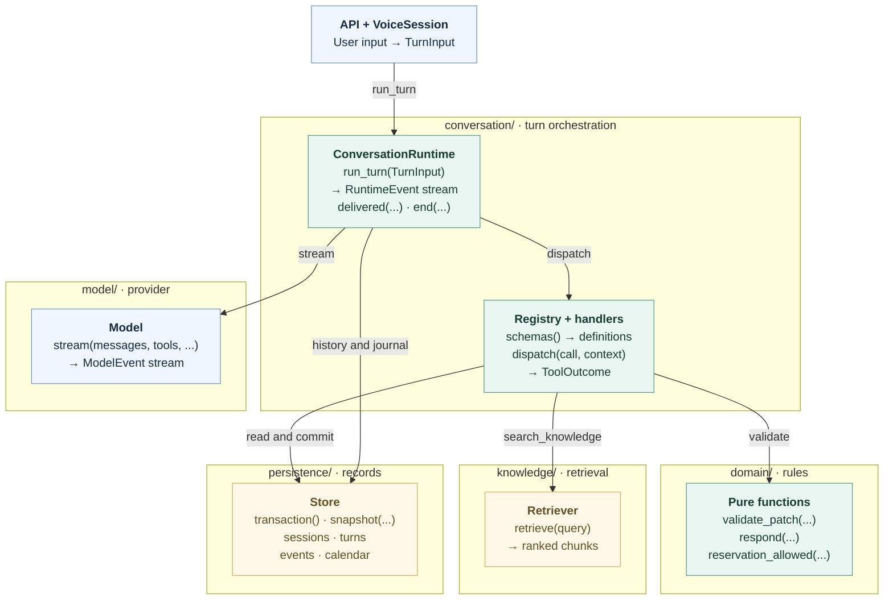
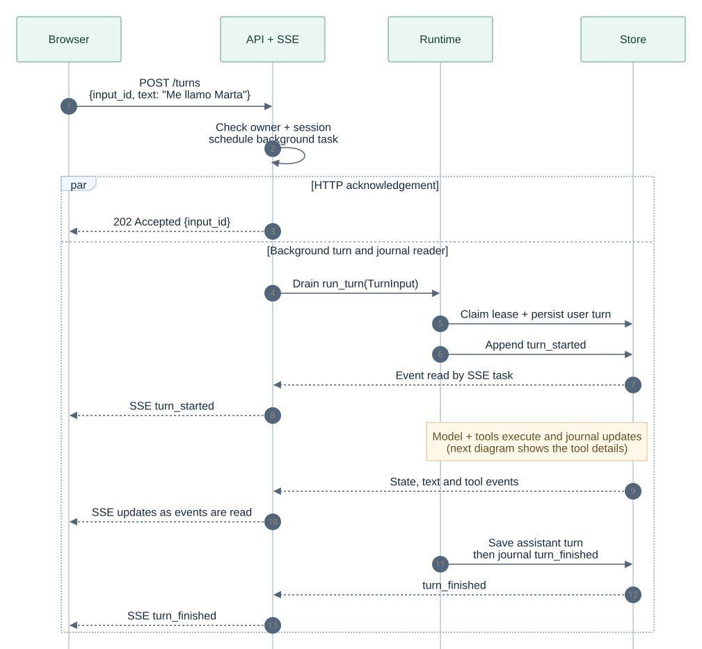
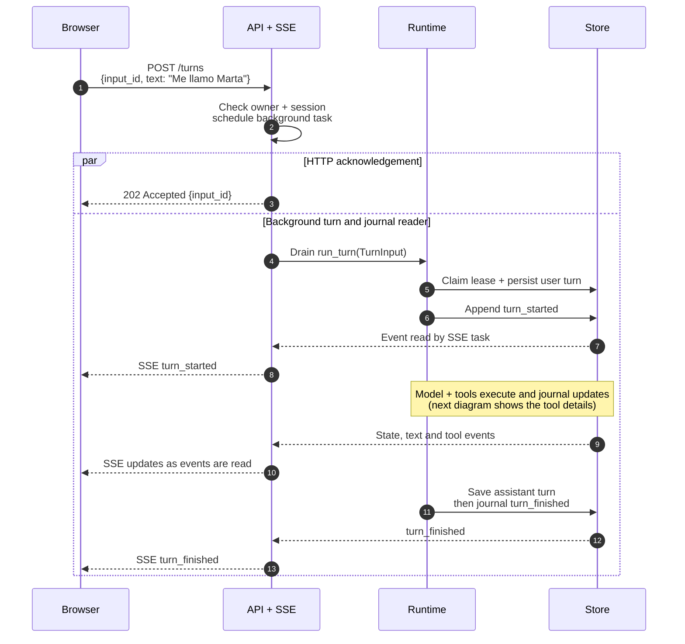
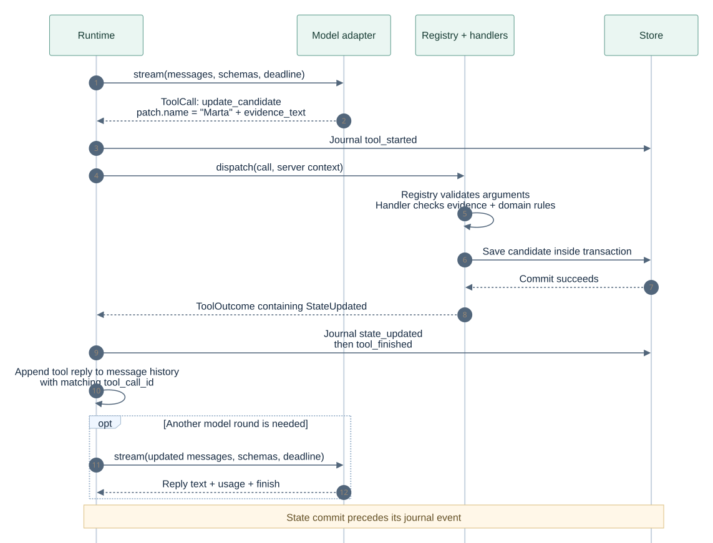
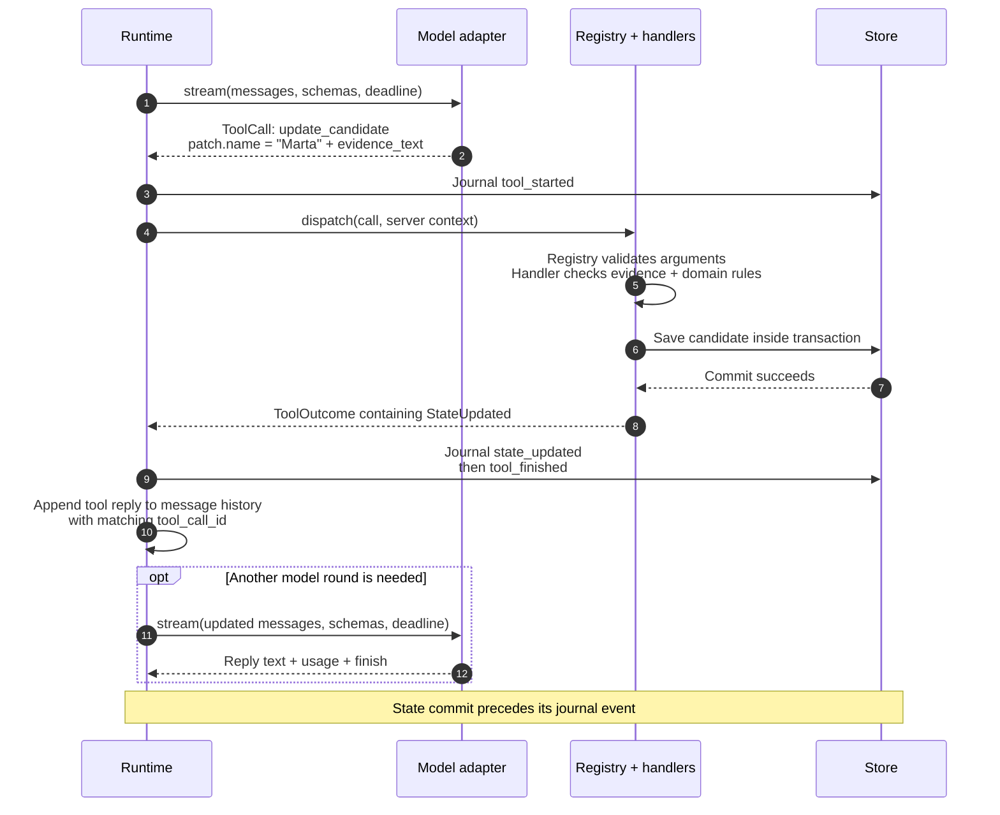
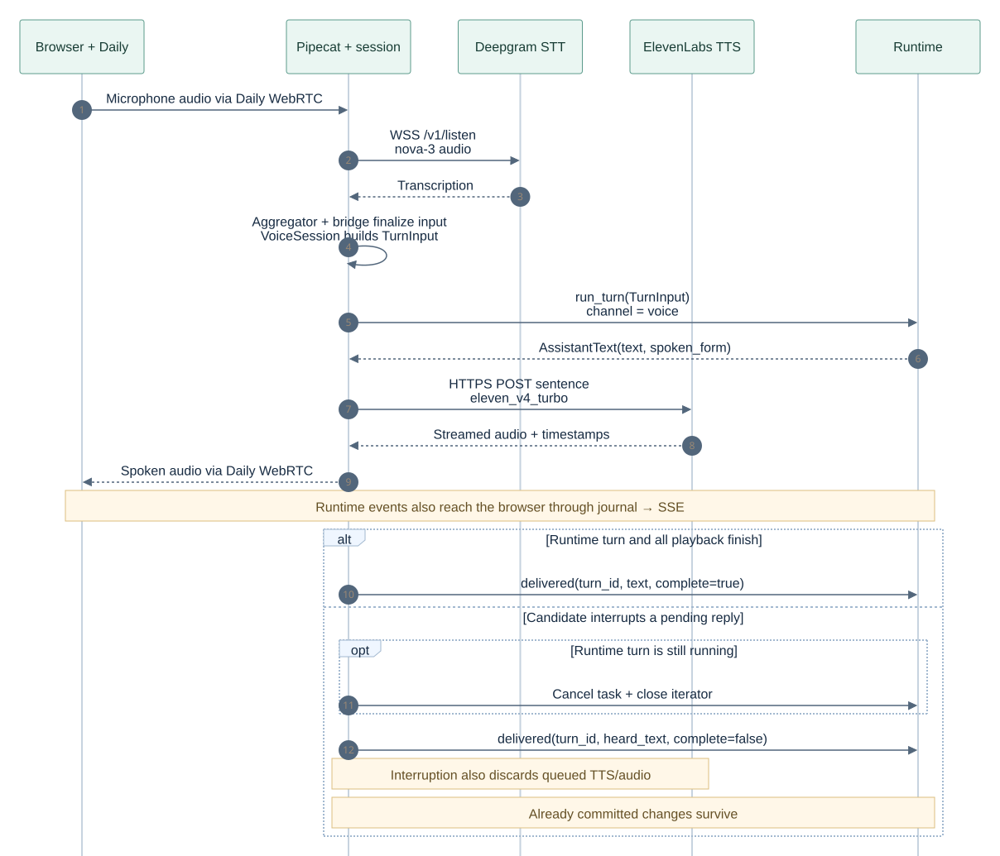
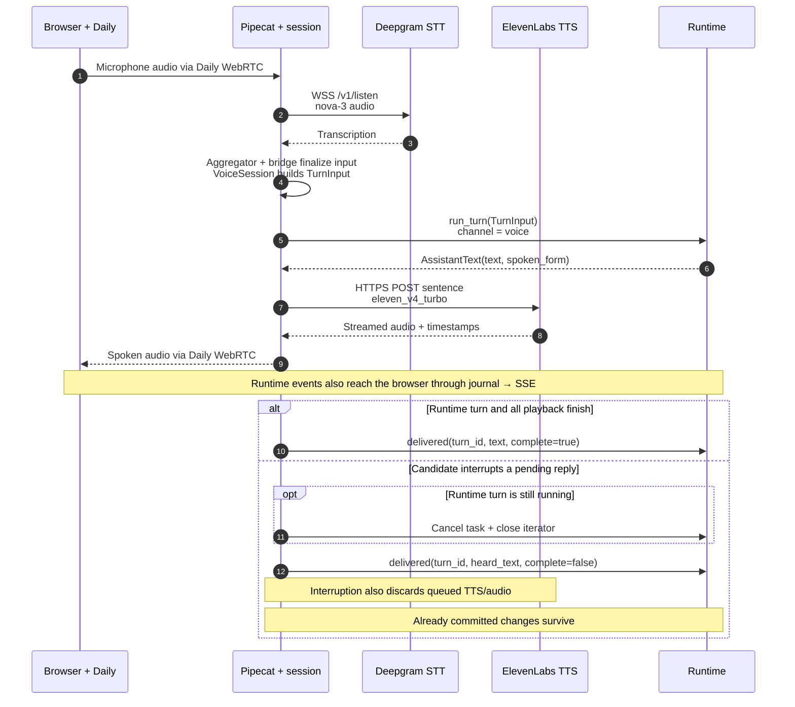
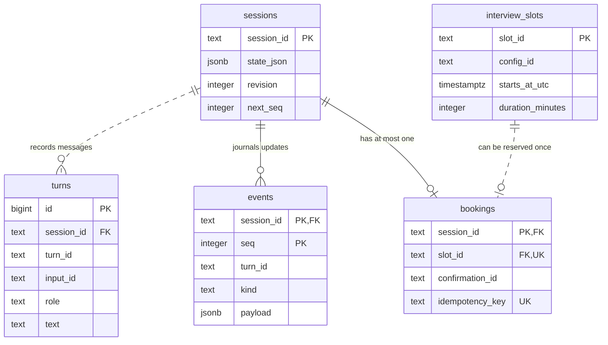

# A visual guide to Café Norte

**Two channels. One conversation engine.** The browser sends text or audio; the server
turns it into candidate facts, answers and a simulated interview booking.

Each diagram is an embedded SVG, so it displays in Markdown previews without a Mermaid
plugin. Expand **Mermaid source** below a diagram to see or edit its source.

[Protocols](#protocols) · [Module APIs](#module-apis) · [Text chat](#text-chat) · [A tool call](#a-tool-call) ·
[Voice](#voice) · [Database](#database)

## Protocols

**ElevenLabs uses HTTPS streaming. Deepgram still uses a secure WebSocket.** These are
independent connections. Browser text chat uses HTTP commands plus SSE; the application
exposes no WebSocket chat endpoint.

| Connection | Transport in this code | Implementation |
| --- | --- | --- |
| Browser ↔ API | JSON over HTTP (HTTPS when hosted); session events over HTTP SSE | [client](../web/src/api/client.ts), [routes](../src/cafe_norte/api/routes.py), [SSE](../src/cafe_norte/api/events.py) |
| Browser ↔ Daily ↔ server | WebRTC **audio**; Daily SDKs own connection signaling | [browser voice](../web/src/voice.ts), `DailyTransport` in [pipeline](../src/cafe_norte/voice/pipeline.py) |
| Server → Daily room service | HTTPS REST for rooms and meeting tokens | [`DailyRooms`](../src/cafe_norte/voice/daily.py) |
| Server ↔ Deepgram STT | **WSS** `/v1/listen`, audio in and transcripts out; `nova-3` | `DeepgramSTTService` in [pipeline](../src/cafe_norte/voice/pipeline.py) |
| Server → ElevenLabs TTS | **HTTPS POST**, streamed response with timestamps; `eleven_v4_turbo` | [`PrefetchingElevenLabsHttpTTSService._post`](../src/cafe_norte/voice/tts.py), [model constant](../src/cafe_norte/voice/contracts.py) |
| Server → chat model | HTTPS Chat Completions POST with SSE response | [`ChatCompletionsModel.stream`](../src/cafe_norte/model/chat_completions.py), [provider URLs](../src/cafe_norte/model/select.py) |
| Server → optional decision model | HTTPS JSON request/response | [`DecisionsModel.decide`](../src/cafe_norte/model/decisions.py) |

The Deepgram transport was checked through the versions in [uv.lock](../uv.lock):
`pipecat-ai 1.13.0` calls `AsyncDeepgramClient.listen.v1.connect` from `deepgram-sdk 7.14.0`;
that SDK opens `websockets_client_connect` to `wss://api.deepgram.com/v1/listen`.
ElevenLabs instead inherits `ElevenLabsHttpTTSService` and posts to
`https://api.elevenlabs.io/v1/text-to-speech/{voice}/stream/with-timestamps`. The HTTP choice
for v4 applies to **synthesis**, not to Deepgram's separate **recognition** connection.

These are the configured provider paths. With no environment configuration, voice is off,
the model is fake and storage is in memory. Knowledge retrieval is local; server-module
arrows below represent Python calls. The media diagrams show Daily's audio path, not its
SDK-internal signaling. Sequence examples show selected successful paths and explicitly
label grouped components.

## Module APIs

**Outer boxes show ownership; inner cards show the API you call.** Blue marks channel/provider
boundaries, green marks conversation and rules, and amber marks data. Arrows show the main
turn-processing calls; connections between server modules are Python calls within one process.
Cards show key methods; linked contracts give the full signatures.



<details>
<summary>Mermaid source</summary>



</details>


A **deep module** exposes a small API while hiding substantial work. For example,
`run_turn(input)` hides history, turn ordering, leases, model/tool rounds, cancellation and
journaling. Callers supply a `TurnInput` and consume events; those details stay inside.

| Module | What callers need to know | What it hides |
| --- | --- | --- |
| [Conversation](../src/cafe_norte/conversation/contracts.py) | `TurnInput` in; `RuntimeEvent` stream out | Execution limits, history, tools and event ordering |
| [Model](../src/cafe_norte/model/contracts.py) | `stream(messages, tools, deadline)` | Provider HTTP stream, delta parsing and cancellation; real or fake adapter |
| [Tools](../src/cafe_norte/conversation/registry.py) | `dispatch(call, context)` → `ToolOutcome` | Argument validation and handler selection; context is server supplied |
| [Domain](../src/cafe_norte/domain/) | Pure functions on typed values → result or refusal | Evidence, field, read-back and booking rules |
| [Knowledge](../src/cafe_norte/knowledge/contracts.py) | `retrieve(query)` → ranked chunks | Store/version filtering, BM25 and optional local embeddings |
| [Persistence](../src/cafe_norte/persistence/contracts.py) | `Store` repositories, transactions and snapshots | Memory/Postgres implementation, revisions, leases and replay |
| [Browser](../web/src/page/reducer.ts) | Actions → state and effects; `Runner.run(effect)` / `dispose()` | HTTP, SSE and voice through injected ports |

[main.py](../src/cafe_norte/main.py) chooses adapters and wires these objects together.
The registry delegates calls to handlers; the handlers call domain rules, retrieval and
storage. The API also reads `Store` directly for snapshots, exports and SSE. Optional
[`SignalAnalyzer`](../src/cafe_norte/conversation/contracts.py) and
[`Telemetry` / `Span`](../src/cafe_norte/observability/contracts.py) attach analysis and
observations to turns; they are omitted from the main map for readability.

The [browser reducer](../web/src/page/reducer.ts) stays pure; its
[effect runner](../web/src/page/effects.ts) performs I/O through replaceable `Ports`.
[`usePage`](../web/src/page/usePage.ts) connects both to React. Transcript bubbles come from
turn events; candidate facts come from `state_updated`.

The browser's HTTP types are generated from [Python API declarations](../src/cafe_norte/api/contracts.py)
via [JSON Schema](../web/src/api/contracts.schema.json) into
[TypeScript](../web/src/api/contracts.ts). Run `make export-schema` after changing those
contracts. The types support compilation; incoming JSON is currently cast without runtime
schema validation. Full module contracts stay beside their public declarations.

## Text chat

**A POST submits work. SSE brings back what happened.** Example: the candidate types
“Me llamo Marta”. Read downward; numbered arrows show order, and dashed arrows carry results.
The SSE connection is already open when this sequence starts. Session endpoints below
use the prefix `/api/sessions/{id}`. This example assumes a new name is successfully saved.



<details>
<summary>Mermaid source</summary>



</details>


`202 Accepted` means the background task was scheduled. It does not mean the input was
already persisted: there is no durable task queue. SSE events can arrive before the browser
receives the HTTP response. The API drains
`run_turn` in a background task; SSE reads the **stored event journal**. Closing the SSE
connection stops its reader, not the accepted text turn. After acceptance, handled execution
failures arrive as `turn_failed` events. `turn_finished` ends a turn,
not the SSE connection; a later `signal_recorded` can still arrive.

SSE pulls from `Store.events.since`. The Postgres adapter [polls committed rows](../src/cafe_norte/persistence/postgres/events.py);
it does not use database notifications or a WebSocket. The diagram shows selected journal
events, with each state change committed before its corresponding event is appended.

[API routes](../src/cafe_norte/api/routes.py) · [SSE stream](../src/cafe_norte/api/events.py) ·
[Runtime](../src/cafe_norte/conversation/runtime.py)

### Reconnect and resume

The [SSE reader](../src/cafe_norte/api/events.py) uses each event's session-local `seq` as
its SSE ID. Native `EventSource` reconnects with `Last-Event-ID`; the
[browser reducer](../web/src/page/reducer.ts) ignores events already applied. Opening a
private resume link restores the owner cookie, loads snapshot metadata and starts a fresh
stream from sequence zero. The transcript and candidate panel are rebuilt from events.
Postgres preserves this history across restarts; the memory adapter does not.

A `session_id` identifies the conversation; `turn_id` links one execution's transcript,
events and usage. Reusing a submitted `input_id` on an active session produces
`turn_failed(conflict)`, not the original reply. The page does not automatically retry POSTs.
`expected_revision` checks session saves and confirmation answers; the runtime does not
check the optional revision on plain text input. See [routes](../src/cafe_norte/api/routes.py)
and [browser effects](../web/src/page/effects.ts).

## A tool call

**The model requests a change; application code validates and commits it.** This is one
possible `update_candidate` call inside the preceding text turn.



<details>
<summary>Mermaid source</summary>



</details>


The tool receives the candidate's words as evidence and a server-created `ToolContext`
with session/turn identity and lease generation. A refused change returns a `ToolOutcome`
explaining the refusal. A successful handler returns `StateUpdated` after committing;
the runtime then journals it in a separate transaction. This name-only example has no
automatic read-back. Tools that return `spoken` text can emit `assistant_text` between
`state_updated` and `tool_finished`. Text held from a model/tool round is released after
the tool results succeed, before another model call if one is needed.

The same pattern handles a booking: `present_confirmation` reads back a slot; the candidate
answers; `reserve_interview` checks the confirmation and writes the booking and session state
in one transaction. The [ten allowlisted tools](../src/cafe_norte/conversation/tools.py)
are local operations, not HTTP endpoints.

[Tool handlers](../src/cafe_norte/conversation/handlers.py) ·
[Candidate rules](../src/cafe_norte/domain/candidate.py) ·
[Booking rules](../src/cafe_norte/domain/booking.py)

## Voice

**Daily audio uses WebRTC, Deepgram transcription uses WSS, and ElevenLabs v4 uses HTTPS.**
Conversation state still arrives over SSE. First, the browser posts
`/api/sessions/{id}/voice`. The API reserves capacity, provisions a private Daily room and
starts the bot. It returns a room URL and candidate token after the bot joins. The browser
then joins that room; the bot token stays on the server.



<details>
<summary>Mermaid source</summary>



</details>


**STT** converts speech to text; **TTS** converts reply sentences to audio. The
“Pipecat + session” lifeline deliberately groups the media pipeline, bridge and `VoiceSession`.
`VoiceSession` receives finalized text and runtime events; it does not send microphone audio
to Deepgram or make ElevenLabs requests itself. One reply sentence is shown; generation,
audio downloads and playback can overlap, and interruption can occur while any is pending.

The actual frame order in [`PipecatVoiceController.build`](../src/cafe_norte/voice/pipeline.py)
is `Daily input → Deepgram → SpeechTap → LLMUserAggregator → InboundBridge → ElevenLabs
HTTP TTS → Daily output → PlaybackTap`. The aggregator uses Silero VAD, a word-based
start strategy and the local Smart Turn v3 analyzer. `InboundBridge` calls
`VoiceSession.transcript`; the injected `speak` callback sends `TTSSpeakFrame` back into TTS.
`UsageObserver` meters provider frames alongside this pipeline.

| Voice boundary | Small API | What it owns |
| --- | --- | --- |
| API → [`RoomProvisioner`](../src/cafe_norte/voice/contracts.py) | `create`, `destroy` | Private room and scoped tokens |
| API → [`VoiceSessionController`](../src/cafe_norte/voice/contracts.py) | `start`, `stop`, `wait`, `status` | Pipecat task and call lifecycle |
| Pipeline → [`SessionPort`](../src/cafe_norte/voice/bridge.py) | `transcript`, `interrupted`, `played_one`, `heard_speech` | Translation of frames into session actions |
| Voice → [`VoiceRuntime`](../src/cafe_norte/voice/session.py) | Runtime subset including `run_turn`, `delivered` | Shared conversation behavior and delivery records |

The success acknowledgement waits for both runtime completion and the delivery ledger
to drain. `PlaybackTap` reports output completion to `VoiceSession.played_one`; this is
the server's best available playback record, not a browser receipt for every word.
An interrupted read-back needs review before it can authorize confirmation.
When the call ends, the pipeline reports speech usage and `VoiceSession.close` calls
`runtime.end(..., "shutdown")` to pause a nonterminal session. The API cleanup task then
destroys the room and releases voice capacity. An explicit `/end` separately finalizes the
session with `"stop"`.

[Pipeline](../src/cafe_norte/voice/pipeline.py) · [Delivery ledger](../src/cafe_norte/voice/delivery.py) ·
[TTS adapter](../src/cafe_norte/voice/tts.py)

## Database

**A session owns the conversation; a booking connects it to one interview slot.** This ER
diagram shows the core Postgres tables and selected columns from the migrations.



<details>
<summary>Mermaid source</summary>



</details>


Read `one → many` as one session having zero or more rows. `One → optional one` means a
session or slot can exist without a booking, but can have at most one. **PK** is a primary
key, **FK** a foreign key and **UK** a unique constraint. A solid relationship means the
parent key is part of the child's primary key; a dotted relationship uses a foreign key
without making it part of that primary key.

- **Candidate facts are a JSON document**, inside `sessions.state_json.candidate`.
  The pending confirmation and lifecycle also live in `state_json`; there is no separate
  candidates or confirmations table. `revision` is generated from the candidate JSON.
- **Turns are messages; events are replayable changes.** User and assistant rows share a
  `turn_id`. SQL enforces uniqueness on both `(session_id, input_id, role)` and
  `(session_id, turn_id, role)`, not on `turn_id` alone. Events use `(session_id, seq)` as their key; `events.turn_id` correlates with
  turns but has no database foreign key.
- **Bookings are exclusive.** `session_id` is the booking primary key and `slot_id` is unique.
  Reusing `idempotency_key` returns the same booking. `confirmation_id` refers to the
  confirmation in application state, not to a separate SQL table.
- **Deleting a session cascades** to its transcript, events and booking. The interview slot
  remains and becomes available again. This is a simulated calendar.

Supporting tables stay outside this core diagram: `usage` and `timings` record observations;
`leases` fences writes; `admission` tracks voice capacity; `resume_tokens` stores token hashes;
`exports` stores final snapshots. All reference `sessions`.

[Initial schema](../src/cafe_norte/persistence/migrations/0001_initial.sql) ·
[Leases, admission and tokens](../src/cafe_norte/persistence/migrations/0002_leases_admission_resume.sql) ·
[Exports and booking cascade](../src/cafe_norte/persistence/migrations/0003_exports_and_cascades.sql) ·
[Remaining migrations](../src/cafe_norte/persistence/migrations/)

## Diagram-to-code review map

Use implementations as the source of truth when a contract comment and its caller disagree.
These are the code paths checked for each picture; provider wire details also depend on
[uv.lock](../uv.lock).

| Diagram | Code to recheck when changing it |
| --- | --- |
| README overview | [`create_default_app`](../src/cafe_norte/main.py), [routes](../src/cafe_norte/api/routes.py), [pipeline assembly](../src/cafe_norte/voice/pipeline.py) |
| Module APIs | [runtime](../src/cafe_norte/conversation/runtime.py), [registry](../src/cafe_norte/conversation/registry.py), [handlers](../src/cafe_norte/conversation/handlers.py) |
| Text chat | [`post_turn` / `TurnTasks`](../src/cafe_norte/api/routes.py), [`_turn` / `_journal`](../src/cafe_norte/conversation/runtime.py), [SSE reader](../src/cafe_norte/api/events.py) |
| Tool call | [`_run_tool` / `_tool_calls`](../src/cafe_norte/conversation/runtime.py), [`UpdateCandidateHandler`](../src/cafe_norte/conversation/handlers.py) |
| Voice | [pipeline](../src/cafe_norte/voice/pipeline.py), [bridge](../src/cafe_norte/voice/bridge.py), [session](../src/cafe_norte/voice/session.py), [HTTP TTS](../src/cafe_norte/voice/tts.py) |
| Database | [all migrations](../src/cafe_norte/persistence/migrations/), [Postgres calendar](../src/cafe_norte/persistence/postgres/calendar.py), [codecs](../src/cafe_norte/persistence/postgres/codecs.py) |

## Keep the pictures current

Edit the Mermaid blocks in this file or the README, then regenerate the committed SVGs:

```sh
make diagrams
```

The [renderer](../scripts/render_diagrams.py) uses a pinned Mermaid CLI via npm and the shared
[diagram theme](assets/diagrams/mermaid-config.json). The first run downloads the renderer
and its browser; `make diagrams ARGS="--puppeteer-config <file>"` can select an existing Chrome installation.
The SVG is the visible preview; the adjacent Mermaid block is its editable source.
Commit both together. When behavior changes, update the relevant source and explanation,
regenerate, and inspect the result; rendering does not verify the diagram against the code.

For configuration and execution, see the [README](../README.md). The choice of module, sequence and ER
views follows the useful distinctions in the
[Gleek diagram guide](https://www.gleek.io/blog/diagram-for-developers).
